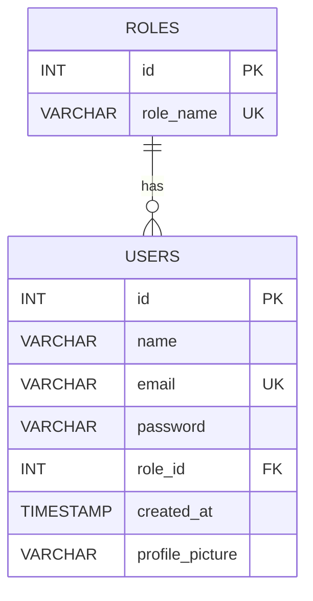

# Entity Relationship Diagram

## Relationship

- One role can be assigned to many users.
- Each user references a role through `users.role_id`.
- `users.role_id` references `roles.id`.
- `users.email` is unique.
- `roles.role_name` is unique.
